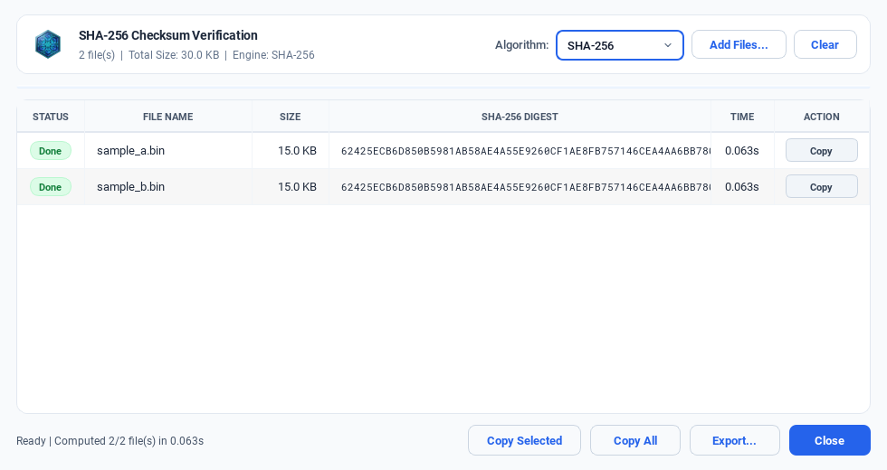
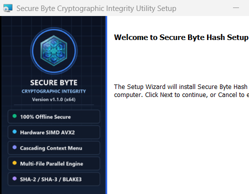
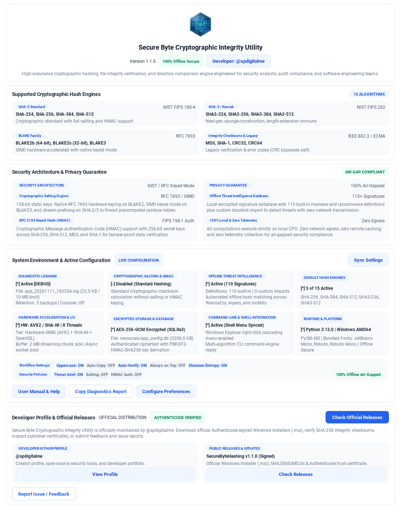

<div align="center">

# Secure Byte Cryptographic Integrity Utility

**Enterprise-grade, 100% offline file integrity verification, cryptographic hashing, and directory comparison engine for Windows.**

[-0078d4.svg)](https://github.com/spdigitalme/SecureByteHashing)
[](https://github.com/spdigitalme/SecureByteHashing)
[](https://github.com/spdigitalme/SecureByteHashing)
[](LICENSE)
[](https://github.com/spdigitalme)

[**User Guide**](USER_GUIDE.md) • [**Developer Profile**](https://github.com/spdigitalme) • [**License**](LICENSE)

</div>

---

## Highlights

- **15 Cryptographic Engines**: SHA-256, SHA-512, SHA-384, SHA-224, SHA3 (224/256/384/512), BLAKE2B, BLAKE2S, BLAKE3 (AVX-512 hardware accelerated), MD5, SHA-1, CRC32, CRC64.
- **Windows Explorer Right-Click Cascading Menu**: Instant file and directory checksum calculation directly from the desktop shell.
- **Multi-File Batch Checksum Window**: Real-time parallel calculation popup with on-the-fly algorithm switching, time tracking, and instant row/bulk clipboard copy.
- **Native WiX Toolset Windows Installer (.msi)**: Clean deployment to `C:\Program Files\SecureByteHash` with desktop/start menu shortcuts, environment variable PATH registration, and standard Control Panel uninstallation.
- **Authenticode Digital Signing**: Signed binaries and installers with trusted RFC 3161 timestamping.
- **100% Offline Air-Gapped Privacy**: Zero telemetry, zero external network connections, local CPU processing only.
- **Encrypted Local Storage**: AES-256-GCM encrypted SQLite3 database for persistent configuration and threat blocklists.

---

## Visual Tour

### 1. Windows Explorer Cascading Menu & Multi-File Processing Popup
Right-click any file or group of files -> **Secure Byte Hashing** -> Choose algorithm:
<div align="center">
  
</div>

### 2. Modern WiX Setup Wizard
Native 64-bit Windows Installer with Material Design 3 artwork:
<div align="center">
  
</div>

### 3. Application Security & Diagnostics Dashboard
Interactive status overview with Developer Profile:
<div align="center">
  
</div>

---

## Release Package & Quick Installation

The official Windows Installer package is included in the **`Release v1.1.0`** folder:

| File Name | Description | Purpose |
| :--- | :--- | :--- |
| **`SecureByteHash-1.1.0-x64.msi`** | Standalone Windows Installer | Complete native setup wizard & uninstaller |
| **`SecureBytePublisher.cer`** | Public Authenticode Certificate | Establishes Windows OS trust for publisher |
| **`install_trust.bat`** | One-Click Trust Tool | Automatically installs `.cer` into Root & TrustedPublisher stores |
| **`SHA256_checksum.txt`** | SHA-256 Integrity Hash | Verifies installer package integrity before installation |

---

## Installation & Windows SmartScreen Setup

### 1. Install Publisher Trust Certificate
To eliminate Windows Defender SmartScreen blocks and establish verified publisher identity:
1. Navigate to the **`Release v1.1.0`** directory.
2. Right-click **`install_trust.bat`** and select **Run as administrator**.
   *(This silently installs `SecureBytePublisher.cer` into Windows Root and TrustedPublisher stores)*

### 2. Verify Download Integrity (SHA-256)
```cmd
certutil -hashfile "Release v1.1.0\SecureByteHash-1.1.0-x64.msi" SHA256
```
Compare the output against the hash in `Release v1.1.0\SHA256_checksum.txt`.

### 3. Run the Installer
Double-click **`SecureByteHash-1.1.0-x64.msi`** in the `Release v1.1.0` folder, or run via Command Prompt:
```cmd
# Interactive GUI Setup
msiexec /i "Release v1.1.0\SecureByteHash-1.1.0-x64.msi"

# Silent Enterprise Deployment
msiexec /i "Release v1.1.0\SecureByteHash-1.1.0-x64.msi" /qn

# Silent Uninstall
msiexec /x "Release v1.1.0\SecureByteHash-1.1.0-x64.msi" /qn
```

---

## Documentation & Resources

- [**User Guide & Walkthrough**](USER_GUIDE.md): Detailed workflow documentation.
- [**License**](LICENSE): MIT License.

---

## Developer

- **Developer Profile**: [@spdigitalme](https://github.com/spdigitalme)
- **Repository**: [spdigitalme/SecureByteHashing](https://github.com/spdigitalme/SecureByteHashing)

