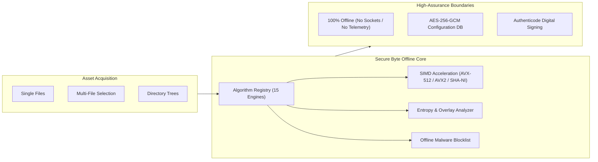
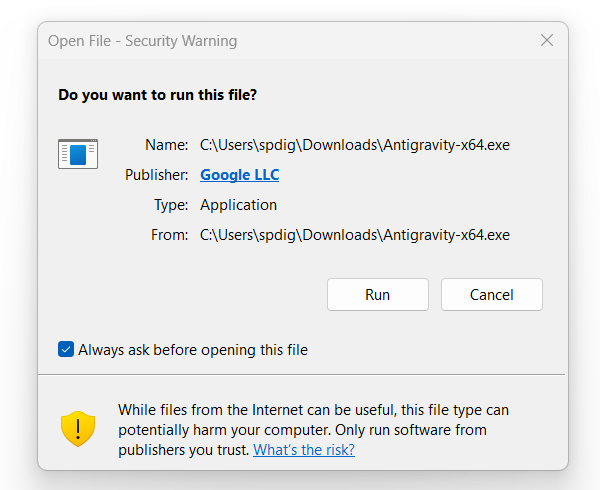
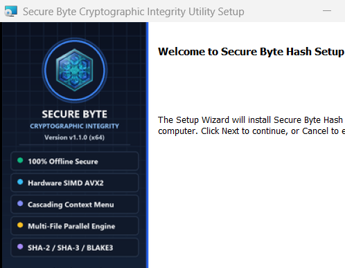
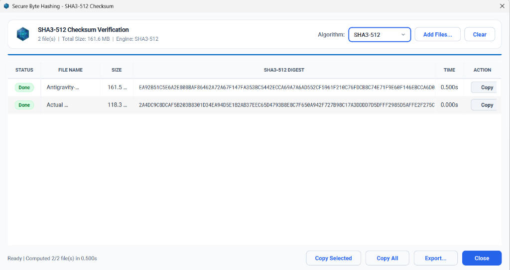
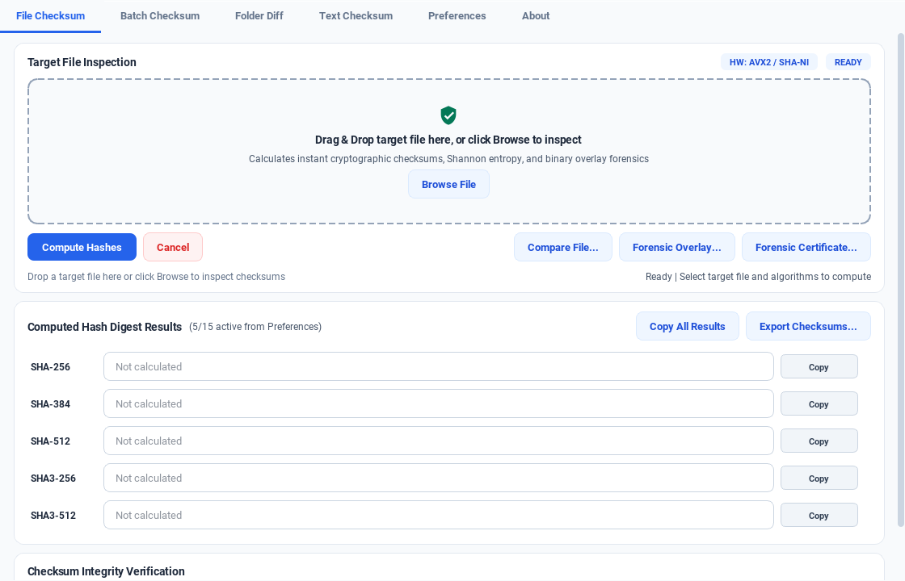
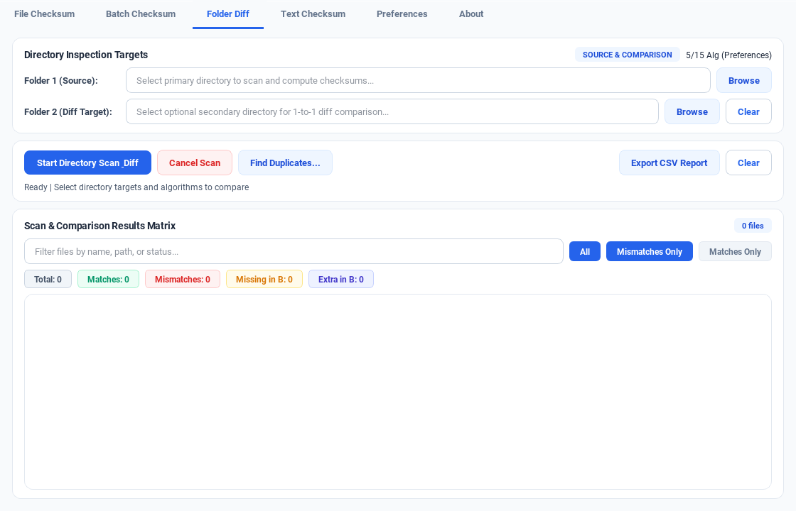
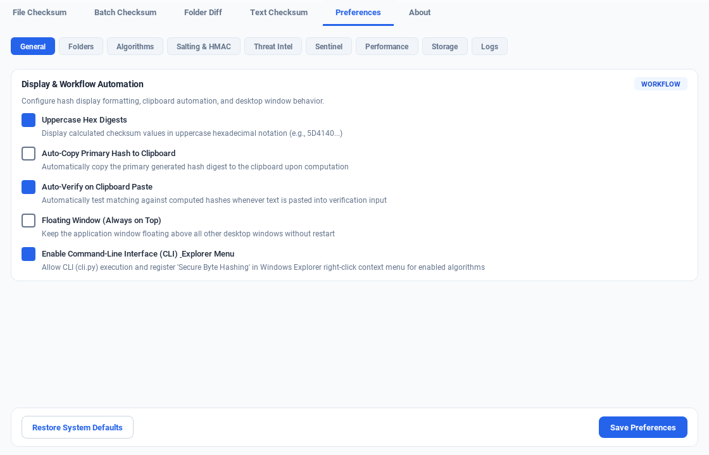
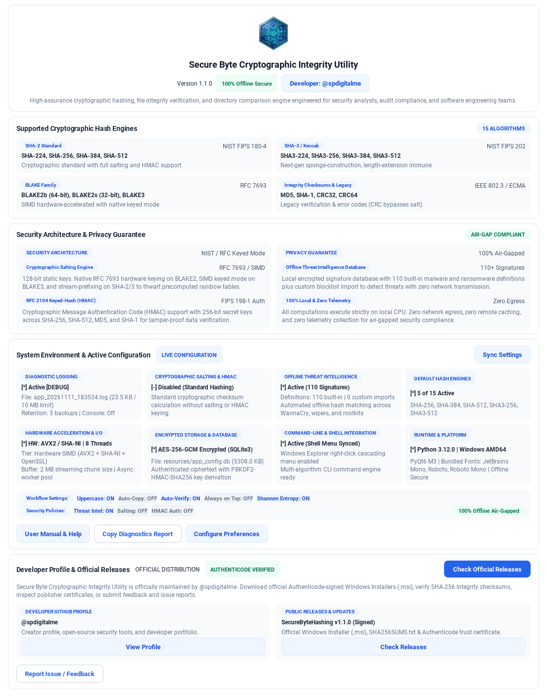

# Secure Byte Cryptographic Integrity Utility — Comprehensive User Manual

<div align="center">


### Official User Manual & Operational Reference Guide
**Version 1.1.0 • 64-Bit Windows Edition (Windows 10 / 11)**  
Maintained by [@spdigitalme](https://github.com/spdigitalme) • Repository: [spdigitalme/SecureByteHashing](https://github.com/spdigitalme/SecureByteHashing)

</div>

---

## 📑 Table of Contents

1. [Security Architecture & Operational Philosophy](#1-security-architecture--operational-philosophy)
2. [Release Package Artifacts](#2-release-package-artifacts)
3. [Installation & Windows SmartScreen Setup](#3-installation--windows-smartscreen-setup)
   - [3.1 SHA-256 Download Integrity Verification](#31-sha-256-download-integrity-verification)
   - [3.2 Installing the Publisher Trust Certificate](#32-installing-the-publisher-trust-certificate)
   - [3.3 Running the WiX Setup Wizard](#33-running-the-wix-setup-wizard)
   - [3.4 Enterprise Unattended Silent Deployment](#34-enterprise-unattended-silent-deployment)
4. [Windows Explorer Cascading Context Menu](#4-windows-explorer-cascading-context-menu)
5. [Multi-File Batch Checksum Processing Window](#5-multi-file-batch-checksum-processing-window)
6. [Primary File Integrity & Forensic Analysis Suite](#6-primary-file-integrity--forensic-analysis-suite)
7. [Directory Tree Auditing & Differential Comparison](#7-directory-tree-auditing--differential-comparison)
8. [Preferences, Cryptographic Salting & Threat Intelligence](#8-preferences-cryptographic-salting--threat-intelligence)
9. [System Telemetry & Developer Profile](#9-system-telemetry--developer-profile)
10. [Troubleshooting & Frequently Asked Questions](#10-troubleshooting--frequently-asked-questions)

---

## 1. Security Architecture & Operational Philosophy

**Secure Byte Cryptographic Integrity Utility** provides deterministic cryptographic verification of digital assets in strictly regulated environments.



### High-Assurance Security Guarantees:
- **100% Offline Air-Gapped Privacy**: The software does not establish outbound or inbound network sockets, execute DNS queries, or communicate with external servers. All cryptographic algorithms run locally on the workstation CPU.
- **Hardware-Accelerated Cryptography**: Automatic vectorization tier detection leveraging Intel/AMD AVX-512, AVX2, and OpenSSL hardware acceleration.
- **AES-256-GCM Encrypted Configuration Database**: Preferences, custom presets, and malware definitions are stored in an authenticated local SQLite3 database protected with PBKDF2-derived master keys.
- **Authenticode Verified**: All executable binaries and Windows Installer packages are digitally signed with a SHA-256 Authenticode certificate and RFC 3161 timestamps.

---

## 2. Release Package Artifacts

All distribution assets are located in the [**`Release v1.1.0/`**](Release%20v1.1.0/) directory:

| Artifact | File Type | Size | Purpose |
| :--- | :--- | :--- | :--- |
| **`SecureByteHash-1.1.0-x64.msi`** | Windows Installer (.msi) | `45.4 MB` | Native 64-bit WiX installer configuring desktop shortcuts, PATH registration, and context menu handlers. |
| **`SecureBytePublisher.cer`** | X.509 Certificate (.cer) | `1.0 KB` | Public code-signing certificate for publisher identity validation. |
| **`install_trust.bat`** | Batch Setup Script | `2.2 KB` | Automated Administrator tool to import `.cer` into Windows Root and TrustedPublisher stores. |
| **`SHA256_checksum.txt`** | Checksum Manifest (.txt) | `64 B` | Cryptographic verification hash for validating package authenticity before installation. |

---

## 3. Installation & Windows SmartScreen Setup

### 3.1 SHA-256 Download Integrity Verification
Before executing the installer, verify that the package has not suffered transmission corruption:

```cmd
certutil -hashfile "Release v1.1.0\SecureByteHash-1.1.0-x64.msi" SHA256
```

Confirm that the output matches the official digest:
```
87e52b7cb2070b3d2deb5bce7d2bf86e09595b7a8740cfdf00c6af3db78dcf92
```

---

### 3.2 Installing the Publisher Trust Certificate

> [!IMPORTANT]
> When executable files are downloaded from the internet, Windows applies the **Mark-of-the-Web (`ZoneId=3`)**. Without pre-installed certificate trust, Microsoft Defender SmartScreen displays a blue block prompt (*"Windows protected your PC"*). Running `install_trust.bat` imports the public certificate into the Windows Certificate Store, which tells Windows to recognize **`Publisher: Secure Byte Security Systems`** as trusted.

1. Navigate to the **`Release v1.1.0`** folder.
2. Right-click **`install_trust.bat`** and select **Run as administrator**.
3. The script verifies elevation and adds the certificate to two system stores:
   - **`LocalMachine\Root`**: Trusted Root Certification Authorities
   - **`LocalMachine\TrustedPublisher`**: Trusted Publishers
4. A confirmation prompt will report `STATUS: [VERIFIED] Publisher certificate is active and trusted!`.

#### What You Will See After Installing Certificate Trust:
When executing the installer, Windows displays a clean, trusted security warning with a direct **`Run`** button:

<div align="center">
  
  <p><em>Verified Publisher Security Dialog with Direct "Run" Action</em></p>
</div>

#### Manual Command Prompt Installation (Alternative):
```cmd
certutil -addstore -f "Root" "Release v1.1.0\SecureBytePublisher.cer"
certutil -addstore -f "TrustedPublisher" "Release v1.1.0\SecureBytePublisher.cer"
```

---

### 3.3 Running the WiX Setup Wizard

Double-click **`SecureByteHash-1.1.0-x64.msi`** to launch the setup wizard:

<div align="center">
  
  <p><em>Material Design 3 High-DPI Supersampled Setup Wizard</em></p>
</div>

1. **Welcome Screen**: Displays application branding and software version. Click **Next**.
2. **License Agreement**: Review and accept the MIT License.
3. **Destination Directory**: Standard default location is `C:\Program Files\SecureByteHash`. Click **Change...** to specify a custom installation directory if required.
4. **Installation Execution**: Click **Install**. The wizard deploys program binaries, configures registry associations, registers system PATH environment variables, and creates shortcuts.
5. **Completion**: Click **Finish** to launch the utility.

---

### 3.4 Enterprise Unattended Silent Deployment

For IT systems administrators deploying across enterprise networks via Microsoft Intune, SCCM, or Group Policy:

```cmd
# Silent Background Installation
msiexec /i "Release v1.1.0\SecureByteHash-1.1.0-x64.msi" /qn

# Silent Installation to Custom Directory
msiexec /i "Release v1.1.0\SecureByteHash-1.1.0-x64.msi" /qn TARGETDIR="D:\SecurityTools\SecureByteHash"

# Silent Clean Uninstallation
msiexec /x "Release v1.1.0\SecureByteHash-1.1.0-x64.msi" /qn
```

---

## 4. Windows Explorer Cascading Context Menu

Secure Byte integrates directly into the Windows Explorer desktop shell:

1. In Windows Explorer, select one file or highlight multiple files.
2. Right-click the selection -> click **Secure Byte Hashing**.
3. Choose your desired algorithm:
   - **SHA-256 Checksum**
   - **SHA-512 Checksum**
   - **BLAKE3 Checksum**
   - **MD5 Checksum**
   - **Open Secure Byte Utility** (Opens main window)

> [!TIP]
> You can toggle the cascading shell menu on or off and choose which algorithms appear in it via **Preferences -> Display & Workflow Automation -> Enable Command-Line Interface (CLI)**.

---

## 5. Multi-File Batch Checksum Processing Window

When selecting files via the right-click menu or the **Batch Checksum** tab, the dedicated multi-file processing window opens:

<div align="center">
  
  <p><em>Real-Time Parallel Batch Hashing Window (SHA3-512 with per-file status badges, sizes, execution times, and instant row copy)</em></p>
</div>

### Features & Capabilities:
- **Concurrent Stream Hashing**: Files are processed using optimized worker thread pools without blocking the user interface.
- **Real-Time Row Metrics**: Displays status (`Done`, `Pending`, `Computing`), file name, size, computed digest, and execution time down to milliseconds.
- **Dynamic Algorithm Switching**: Use the top-right **Algorithm** dropdown to recompute all files with a different algorithm on the fly.
- **One-Click Clipboard Actions**:
  - Click **`Copy`** on any row to copy that single digest to the clipboard.
  - Click **`Copy Selected`** or **`Copy All`** at the bottom for multi-line clipboard exports.
  - Click **`Export...`** to save complete manifests as `.csv` or `.txt` checksum files.

---

## 6. Primary File Integrity & Forensic Analysis Suite

Open the main application from your Desktop or Start Menu to access the **File Checksum** tab:

<div align="center">
  
  <p><em>Primary File Checksum Inspection Dashboard with Drag & Drop Zone, Hardware Acceleration Badge, and Multi-Digest Outputs</em></p>
</div>

### Step-by-Step Operations:
1. **Target Selection**: Drag & drop any target file directly into the inspection drop zone, or click **`Browse File`**.
2. **Multi-Engine Execution**: Click **`Compute Hashes`** to compute digests across all active algorithm families in parallel.
3. **Digest Verification**: Paste an expected checksum into the verification box. The application instantly reports:
   - **`MATCH`** (Green): File matches expected cryptographic integrity.
   - **`MISMATCH`** (Red): File has been modified, corrupted, or tampered with.
4. **Forensic Tools**:
   - **`Forensic Overlay...`**: Detects hidden data appended past the end of valid executable (PE) structures.
   - **`Shannon Entropy Analyzer`**: Calculates entropy score (0.00 - 8.00 bits/byte) to identify encrypted or packed payloads.
   - **`Forensic Certificate...`**: Generates a verifiable digital PDF/Text certificate of integrity.

---

## 7. Directory Tree Auditing & Differential Comparison

Open the **Folder Diff** tab to audit entire directory trees:

<div align="center">
  
  <p><em>Dual-Directory Inspection Matrix with Status Badges (Matches, Mismatches, Missing, Extra) and CSV Export</em></p>
</div>

### Operational Workflow:
1. Specify **Folder 1 (Source)** and optional **Folder 2 (Diff Target)**.
2. Select whether to include subfolders or hidden files.
3. Click **`Start Directory Scan / Diff`**.
4. The scan matrix categorizes all discovered files into color-coded status badges:
   - **`Matches`** (Green): Files identical in both directories.
   - **`Mismatches`** (Red): Files present in both directories with altered content.
   - **`Missing in B`** (Orange): Files present in Source but absent from Target.
   - **`Extra in B`** (Blue): Files present in Target but absent from Source.
5. Use the filter chips (**`Mismatches Only`**, **`Matches Only`**, **`All`**) to isolate discrepancies.
6. Click **`Export CSV Report`** to generate an audit-ready compliance manifest.

---

## 8. Preferences, Cryptographic Salting & Threat Intelligence

Open the **Preferences** tab to configure application policies:

<div align="center">
  
  <p><em>Preferences Tab: Workflow Automation, Algorithm Selection, Threat Intel DB, and Performance Tuning</em></p>
</div>

### Module Breakdown:
- **General**: Configure uppercase/lowercase hexadecimal formatting, auto-copy to clipboard, and always-on-top window behavior.
- **Algorithms**: Enable or disable default hashing algorithms.
- **Salting & HMAC**: Configure secret salt keys or RFC 2104 HMAC authentication keys.
- **Offline Threat Intel**: Enable the offline malware blocklist (automatically flags known ransomware, wipers, and malicious samples).
- **Performance**: Adjust streaming I/O chunk sizes (1 MB to 32 MB) and CPU worker thread pools.

---

## 9. System Telemetry & Developer Profile

The **About** tab provides complete system specifications, hardware vector acceleration status, and developer contact information:

<div align="center">
  
  <p><em>About Tab: Live System Diagnostics Metrics, Air-Gapped Status, and Developer Profile (@spdigitalme)</em></p>
</div>

- **Hardware Acceleration**: Displays active CPU vector tiers (AVX-512, AVX2, SHA-NI).
- **Bundled Typography**: Validates that Roboto and JetBrains Mono typography are loaded from internal storage with zero OS dependencies.
- **Copy Diagnostics Report**: Exports a complete technical specification of active settings and environment metrics to the clipboard.
- **Developer Profile**: Links directly to [@spdigitalme](https://github.com/spdigitalme).
- **Report Issue / Feedback**: Links to the official issue tracker on GitHub.

---

## 10. Troubleshooting & Frequently Asked Questions

#### Q: Windows SmartScreen shows "Windows protected your PC" when running the installer.
> [!NOTE]
> Open-source software self-contained distributions do not use commercial third-party Certificate Authorities. Simply right-click **`Release v1.1.0\install_trust.bat`** and choose **Run as administrator**. Once imported, Windows will trust the installer.

#### Q: How do I cleanly uninstall the application?
> [!TIP]
> Go to **Windows Settings -> Apps -> Installed Apps -> Secure Byte Cryptographic Integrity Utility -> Uninstall**, or run:
> ```cmd
> msiexec /x "Release v1.1.0\SecureByteHash-1.1.0-x64.msi" /qn
> ```
> This completely deletes all binaries, context menu entries, shortcuts, and environment variables.

#### Q: Are any hash calculations sent over the network?
> [!IMPORTANT]
> No. The utility is 100% air-gapped and offline. No network sockets are created, and all hashing runs strictly on your local CPU.

---

## 👨‍💻 Developer & Maintenance

- **Developer**: [@spdigitalme](https://github.com/spdigitalme)
- **Repository**: [spdigitalme/SecureByteHashing](https://github.com/spdigitalme/SecureByteHashing)
- **Issues & Bug Reports**: [GitHub Issues](https://github.com/spdigitalme/SecureByteHashing/issues)

<div align="center">
<sub>Secure Byte Cryptographic Integrity Utility • Enterprise 100% Offline Air-Gapped Verification</sub>
</div>
